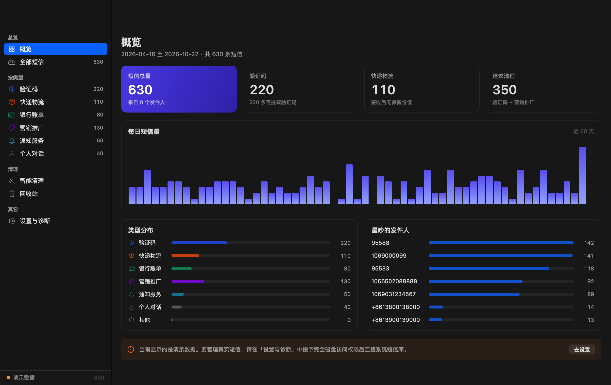
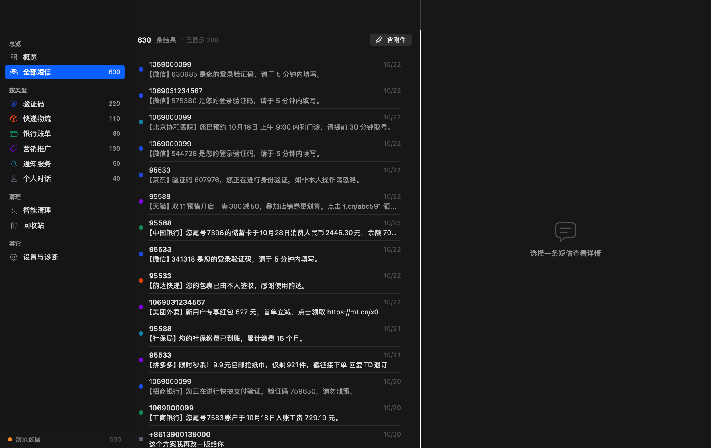
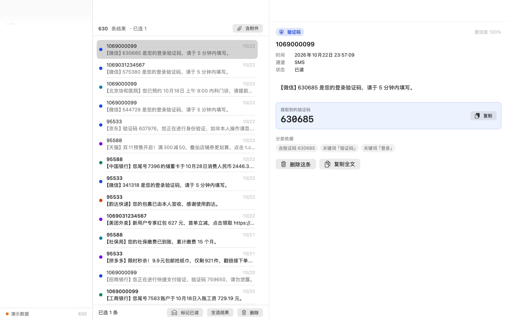
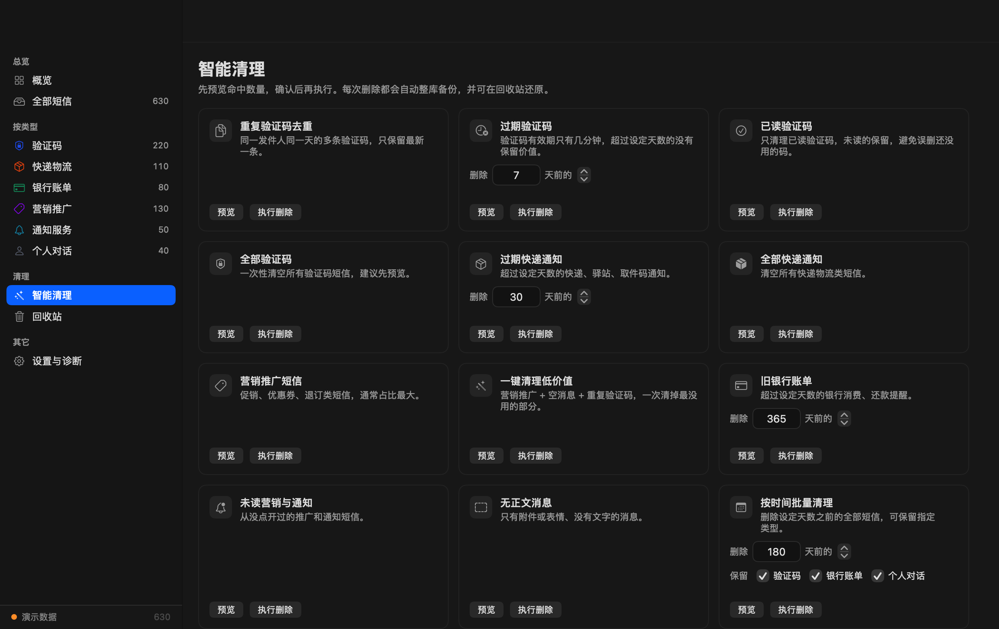

# 短信管家 · SMS Keeper

一个原生 macOS 短信管理工具，直接读取系统「信息」数据库，专注于**批量清理**与**高效检索**。

> English version: [README.en.md](README.en.md)

<p align="center">
  
</p>

<p align="center">
  <a href="https://github.com/HaoRangQi/MacSMSKeeper/releases/latest">
    
  </a>
  
  
  
</p>

## 为什么做这个

macOS 的「信息」App 没有批量管理能力：几万条短信只能一条条滑、搜索很弱、无法按类型清理。
验证码、快递通知、营销短信长期堆积，占空间也干扰查找。

短信管家直接读 `~/Library/Messages/chat.db`，把短信变成可检索、可批量处理的数据，
**删除前自动备份，删错了能整批还原**。

## 功能

### 智能分类

按内容自动分为六类，每条都给出「为什么这样分类」的依据，不是黑盒：

| 类型 | 示例 | 判定依据 |
|---|---|---|
| 验证码 | 「验证码 630685，5 分钟内有效」 | 数字串 + 关键词 + 有效期提示 |
| 快递物流 | 「取件码 3-2-1024，请及时领取」 | 驿站/丰巢/签收等词 + 取件码格式 |
| 银行账单 | 「尾号 8821 消费 128.50 元」 | 卡号/金额/交易类词 |
| 营销推广 | 「限时秒杀，回 TD 退订」 | 促销词 + 退订标记 |
| 通知服务 | 「已预约 10月28日 门诊」 | 预约/航班/账单等通知词 |
| 个人对话 | 「晚上一起吃饭？」 | 个人号码 + 无商业特征 |

### 批量清理

12 条内置规则，**先预览命中数量和样本，再执行**：

- 重复验证码去重（同发件人同天只留最新）
- 过期验证码 / 已读验证码 / 全部验证码
- 过期快递通知 / 全部快递通知
- 营销推广短信
- 一键清理低价值（营销 + 空消息 + 重复验证码）
- 旧银行账单 / 未读营销通知 / 无正文消息
- 按时间批量清理（可保留指定类型）

### 检索

- 多关键词默认 AND
- `"精确短语"`
- `-排除词`
- `/正则/`
- `sender:号码`
- 组合筛选：分类 × 时间范围 × 未读 × 含附件 × 排序
- 命中词高亮，验证码单独提取成一键复制

### 导出

支持 **Markdown / 纯文本 / CSV**，文件名自动带时间戳（`短信导出-20261023-102053.md`）。
列表、多选、单条详情都能导出；有选中就导所选，否则导当前筛选结果。

### 安全机制

删除是危险操作，所以做了多层保护：

1. 删除前**强制退出**「信息」App，避免数据库被占用写坏
2. 整库快照备份（保留最近 20 份）
3. 被删记录完整存档到回收站（含富文本二进制、被清空的会话行）
4. 事务内删除 + WAL checkpoint，失败自动回滚
5. 删除完成后**读回库内条数**校验，不一致直接报错，杜绝「界面说删了但库里没少」

消息与会话在同一个事务里处理：某个会话的短信被删光后，`chat` 表里的会话记录
也会一并清除，「信息」App 列表里不会留下点进去空白的对话；还原时两者一起恢复。

## 系统要求

- macOS **26.0** 或更高（使用 Liquid Glass 设计语言）
- 编译需要 Command Line Tools（`xcode-select --install`），**不需要完整 Xcode**

## 下载安装

不想编译的话，直接去 [Releases](https://github.com/HaoRangQi/MacSMSKeeper/releases/latest)
下载 `MacSMSKeeper-v1.0.0-macos26.zip`，解压后拖到「应用程序」。

> 应用未做代码签名与公证，首次打开请**右键 → 打开**。

## 快速开始

```bash
git clone <repo-url>
cd sms-keeper

make build     # 编译，产物在 build/短信管家.app
make run       # 编译并启动
```

首次打开是**演示数据**（630 条样例），可以随便试删除、试还原，不会碰真实短信。

### 连接真实短信

1. 打开 App → 左侧「设置与诊断」
2. 点「打开系统设置」，在 **隐私与安全性 › 完全磁盘访问权限** 中加入 `短信管家.app`
3. 完全退出 App 并重新打开
4. 回到「设置与诊断」点「连接系统短信库」

> 系统只认 App 本身，不认启动它的终端。授权后必须重启 App 才生效。

## 界面

| 概览 | 列表 |
|---|---|
|  |  |

| 详情 | 智能清理 |
|---|---|
|  |  |

## 项目结构

```
.
├── Sources/
│   ├── App/           应用入口与 AppDelegate（含开发期自检入口）
│   ├── Core/          数据层：SQLite 访问、分类、搜索、删除、导出、演示数据
│   ├── Models/        数据模型与本地化
│   ├── State/         全局状态（AppState）
│   └── UI/            SwiftUI 视图与主题
├── Resources/         Info.plist、应用图标
├── docs/              架构说明、权限说明、截图、导出样例
├── scripts/build.sh   构建脚本
└── Makefile           常用命令
```

## 开发

```bash
make selftest    # 自检：载入 / 分类 / 搜索 / 导航 / 删除还原闭环
make snapshot    # 重新生成 docs/images 下的界面截图
make exporttest  # 重新生成 docs/examples 下的导出样例
make clean       # 清理构建产物
```

自检输出示例：

```
[test] 演示=true 条数=630 载入耗时 169ms
[test] 分类 验证码=220 快递物流=110 银行账单=80 营销推广=130 通知服务=50 个人对话=40
[test] 搜索「取件码」：56 条，1ms
[test] 单击一行 -> 选中 1
[test] 删除 8 条 -> ok=true 剩余 622
[test] 还原 8 条 -> 630（原始 630） 正文不一致 0
[test] 结论 通过
```

更多细节见 [docs/architecture.md](docs/architecture.md) 与 [docs/permissions.md](docs/permissions.md)。

## 性能

1 万条短信的基准（M1 Pro）：

| 环节 | 耗时 |
|---|---|
| 读取数据库 | ~150 ms |
| 分类判断 | ~1.4 s（分块执行，带进度条） |
| 统计 + 筛选 | ~20 ms |
| 切换分类 | 0–8 ms |
| 搜索 | ~25 ms |

## 发版

### 前置条件（换新机器时看这里）

`scripts/release.sh` 会在开跑前自动检查下面这些，缺什么会直接告诉你，不会跑到一半才失败：

| 要求 | 说明 |
|---|---|
| macOS 26+ | 项目用到 Liquid Glass，`xcrun --show-sdk-version` 必须 ≥ 26 |
| Command Line Tools | 提供 `make` / `python3` / `swiftc` / `xcrun`。没有就跑 `xcode-select --install` |
| 工作区干净 | `git status` 不能有未提交改动 |
| 版本号未被占用 | tag `v<版本号>` 不存在 |
| 本地化词条完整 | `python3 scripts/check-localization.py` 通过 |
| GitHub 凭据 | 见下 |

**GitHub 凭据**三种方式任选其一：

1. 在终端执行一次 `git push`，按提示登录（macOS 会把凭据存进 Keychain，之后发版自动取用）
2. `export GITHUB_TOKEN=<Personal Access Token>`（需要 `repo` 权限）
3. 装 GitHub CLI：`gh auth login`，然后 `export GITHUB_TOKEN=$GH_TOKEN`

### 方式一：本地一键发版（现在就能用）

在一台 macOS 26+ 的 Mac 上：

```bash
./scripts/release.sh 1.1.0
```

依次完成：工具链检查 → 本地化检查 → 凭据检查 → 自检 → 打包 → 打 tag 推送代码 → 创建 Release 上传安装包。
不需要安装 `gh`。

### 方式二：CI 自动发版

推送 tag 即触发：

```bash
git tag -a v1.1.0 -m "短信管家 1.1.0"
git push origin v1.1.0
```

或在 GitHub 网页上进 Actions › Release › Run workflow 填版本号。

> 当前 GitHub 托管的 macOS runner 最高到 macOS 15，低于本项目要求的 26 SDK，
> 所以 CI 会跳过构建并提示改用方式一。**等 GitHub 提供 macOS 26 runner 后，
> 不需要改任何配置就会自动开始构建和发版。**

### CI 还包含

| 工作流 | 作用 |
|---|---|
| Validate | 本地化词条检查（重复 key / 缺失词条 / 占位符不一致）、README 图片引用、文档完整性 |
| Build | 编译 + 自检，产物作为 artifact 上传 |

## 出问题时

打开「设置与诊断 › 诊断日志」，重现一次操作，把日志发给开发者。
日志只记录操作步骤和错误信息，**不记录短信内容、号码或验证码**（代码层强制）。
详见 [docs/troubleshooting.md](docs/troubleshooting.md)。

## 数据与隐私

- 所有处理都在本机完成，**不联网、不上传**
- 读取的是数据库副本，原库只在删除时写入
- 回收站与备份存放在 `~/Library/Application Support/SMSKeeper/`

## 已知限制

- 只管理**同步到 Mac 上**的短信。若没有开启 iCloud 信息同步或 iPhone 短信转发，
  Mac 上可能只有 iMessage 而没有运营商短信
- 删除会写入系统数据库，已删除的短信通常不会在其它设备恢复
- 若开启了 **iCloud 信息同步**，本地删除可能在下一次「信息」App 启动时被从
  iCloud 同步恢复。删除后请留意「已删除 N 条 · 库内剩余 M 条」的提示，
  若数字对不上就是被写回了，此时需要先在「信息」App 内删除或暂时关闭同步
- 未做代码签名公证，首次打开可能需要在「隐私与安全性」中允许

## 许可证

[MIT](LICENSE)
